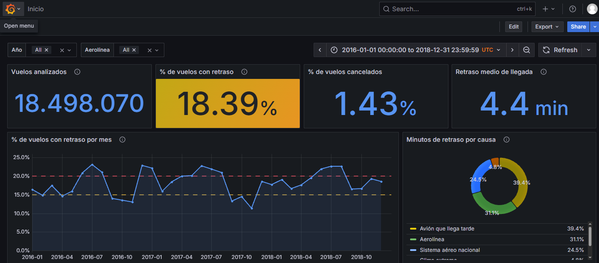
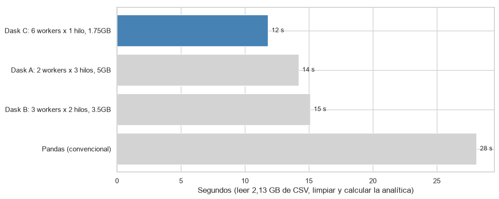

# Retrasos de vuelos domésticos en Estados Unidos, 2016–2018

Proyecto del curso **Big Data** (Universidad de La Sabana, profesor Rodolfo Meza). Analiza 18,5 millones de vuelos domésticos de Estados Unidos (2,13 GB) para identificar qué factores se asocian a que un vuelo llegue con 15 minutos o más de retraso, siguiendo la metodología CRISP-DM.



## Arquitectura

```
CSV anuales ──► PostgreSQL local (Docker) ──► Flujo de Prefect ──► PostgreSQL en AWS RDS ──► Grafana
                (vuelos originales)          (consulta, limpieza,   (solo resultados        (tablero
                                              indicadores)           de la analítica)        gerencial)

Dask: la misma limpieza y analítica en paralelo, comparando configuraciones de workers y memoria.
```

## Contenido del repositorio

| Ruta | Qué contiene | Punto del enunciado |
|---|---|---|
| `notebooks/eda_vuelos_final.ipynb` | Análisis exploratorio: nulos, valores atípicos, distribuciones, relaciones entre variables y validación de hipótesis | b |
| `notebooks/contexto_vuelos.ipynb` | Información adicional de contexto: tipo de aerolínea, festivos, eventos extremos, ubicación de aeropuertos y clima diario | c |
| `notebooks/dask_vuelos.ipynb` | Procesamiento con Dask: tres configuraciones de workers y memoria frente a pandas, y comparación CSV frente a Parquet | e |
| `flujo_vuelos/` | Flujo ETL recurrente con Prefect, carga de resultados a AWS y tablero de Grafana (ver `flujo_vuelos/GUIA.md`) | d, f, g |
| `docs/img/` | Capturas del tablero de Grafana y del panel de Dask | — |

Los notebooks se suben ya ejecutados, con sus resultados y gráficos.

## Datos

Se usan los archivos `2016.csv`, `2017.csv` y `2018.csv` (2,13 GB, 18.505.725 filas) de [Airline Delay and Cancellation Data, 2009 – 2018](https://www.kaggle.com/datasets/yuanyuwendymu/airline-delay-and-cancellation-data-2009-2018) (Kaggle), construido a partir del reporte *On-Time Performance* de la Oficina de Estadísticas de Transporte de EE. UU. (BTS).

Los CSV **no están en el repositorio** por su tamaño. Para correr los notebooks, descárguelos de Kaggle y cópielos en la carpeta `notebooks/`; para el flujo de Prefect, en `flujo_vuelos/datos_nuevos/`. Los CSV originales no se modifican: toda la limpieza se hace con código.

- **Unidad de análisis:** un vuelo doméstico programado.
- **Variable objetivo:** `RETRASADO` = 1 si el vuelo operado llegó con 15 minutos o más de retraso (umbral oficial del DOT).

## Cómo reproducirlo

### 1. Notebooks (EDA, contexto y Dask)

```
conda create -n bigdata_env python=3.12
conda activate bigdata_env
pip install -r notebooks/requirements.txt
```

Abra los notebooks desde la carpeta `notebooks/` (donde están los CSV) y ejecútelos en orden.

Para `dask_vuelos.ipynb` el clúster se levanta a mano en dos ventanas de Anaconda Prompt, como en clase, y se cambia el comando del worker para cada configuración:

```
dask scheduler
dask worker tcp://127.0.0.1:8786 --nworkers 2 --nthreads 3 --memory-limit 5GB      (A)
dask worker tcp://127.0.0.1:8786 --nworkers 3 --nthreads 2 --memory-limit 3.5GB    (B)
dask worker tcp://127.0.0.1:8786 --nworkers 6 --nthreads 1 --memory-limit 1.75GB   (C)
```

### 2. Flujo de Prefect, AWS y Grafana

Siga `flujo_vuelos/GUIA.md`. En resumen:

1. Crear una base PostgreSQL en Amazon RDS.
2. Copiar `flujo_vuelos/.env.ejemplo` como `.env` y escribir las conexiones y contraseñas (el `.env` no se sube a GitHub).
3. `docker compose up -d` levanta PostgreSQL local, la interfaz de Prefect (puerto 4200) y Grafana (puerto 3000).
4. Copiar los CSV en `datos_nuevos/` y ejecutar `python etl_vuelos.py`. Cuando llega un año nuevo, basta con copiarlo y volver a ejecutar.

## Resultados principales

| Indicador | Valor |
|---|---|
| Vuelos analizados (después de la limpieza) | 18.498.070 |
| Vuelos operados con 15 minutos o más de retraso | 18,39 % |
| Vuelos cancelados | 1,43 % |
| Retraso por hora de salida | 7 % a las 5:00 → 26 % a las 18:00 |
| Minutos de retraso que dependen de la aerolínea (problemas propios + avión que llega tarde) | 70,6 % |
| Retraso en días con más de 20 mm de lluvia (30 aeropuertos principales) | 36,5 % (frente a 16,4 % sin lluvia) |
| Tiempo de la analítica: pandas frente a Dask (6 workers × 1 hilo) | 28,1 s → 11,8 s (2,4 veces más rápido) |
| Tamaño de los datos: CSV frente a Parquet | 2,13 GB → 0,29 GB |



## Tecnologías

Python (pandas, Dask, matplotlib, seaborn), Prefect 3, PostgreSQL 16, Docker, Amazon RDS (AWS Academy), Grafana, DBeaver.

## Integrantes

- [Nombre y apellido del integrante 1]
- [Nombre y apellido del integrante 2]
- [Nombre y apellido del integrante 3]
